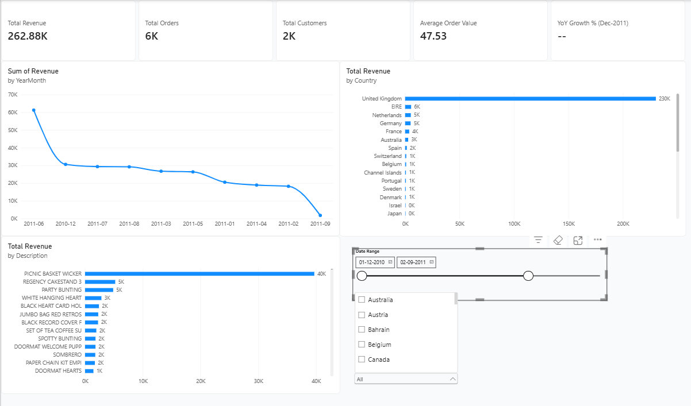
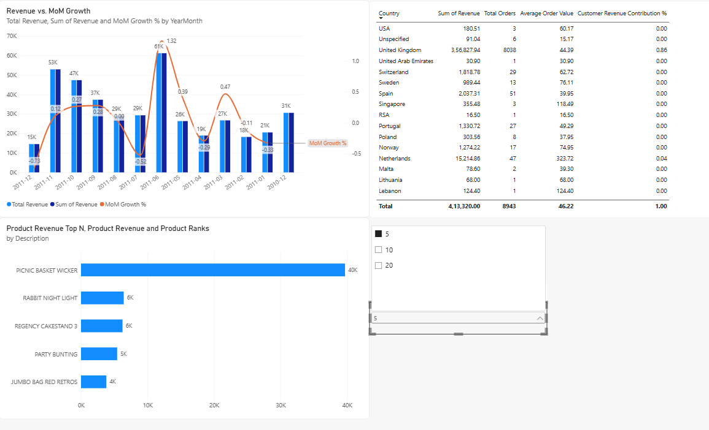
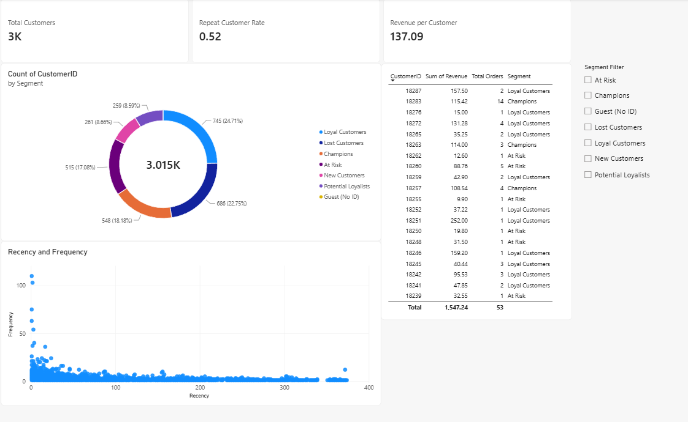
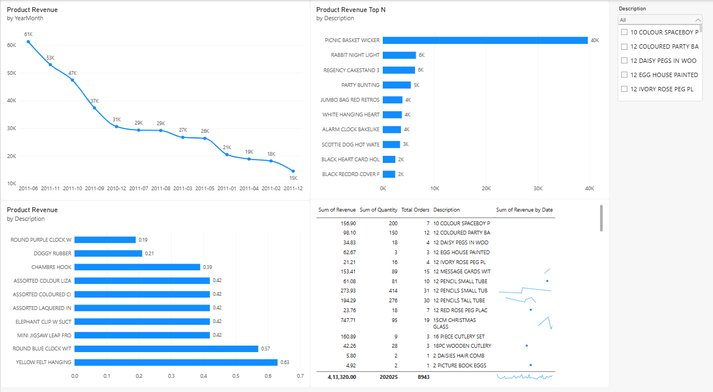
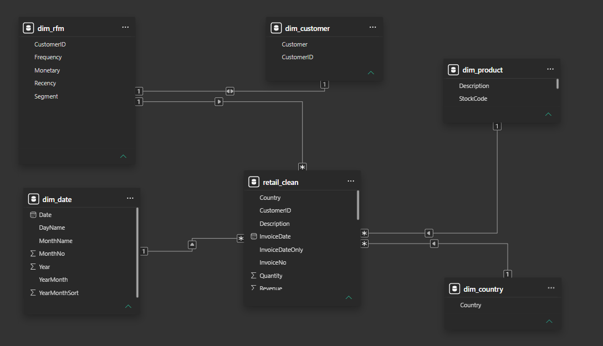

# E-commerce Sales & Customer Intelligence — Power BI

An interactive Power BI report for exploring e-commerce sales performance, customer behaviour, RFM segments, and product performance. This dashboard is the Power BI layer of the **E-commerce Sales & Customer Intelligence** portfolio project.

## Dashboard file

- **Report:** `Ecommerce_Sales_Customer_Intelligence.pbix`

Open the `.pbix` file in Microsoft Power BI Desktop to explore the report and interact with its visuals and filters.

## Report pages

The report contains four pages:

### 1. Executive Overview
A high-level view of business performance, intended to help users quickly review key sales and revenue indicators.



### 2. Sales Performance
A page for examining sales performance and trends across the available transaction data.



### 3. Customer Intelligence
A customer-focused page for exploring customer behaviour and RFM segmentation. RFM stands for **Recency, Frequency, and Monetary value**.



### 4. Product Intelligence
A page for reviewing product performance using the available sales data.



## Data and project workflow

This report is part of a multi-tool analytics project that uses:

- **Excel** for initial data review and data-quality checks.
- **MySQL** for storing and querying cleaned transaction data.
- **Python** for data cleaning, exploratory data analysis, time-series analysis, and RFM customer analysis.
- **Power BI** for interactive reporting and business exploration.

The main sales dataset is represented by `retail_clean`. RFM customer metrics are generated in the Python analysis workflow and exported to `python/rfm.csv` for use in Power BI.

> Keep the data source paths and credentials configured for your own environment. The `.pbix` file may need its data source settings refreshed when opened on another computer.

## Data model

The Power BI model includes the sales data and supporting date, customer, product, and RFM tables used by the report. The model relationships are intended to connect transaction-level sales with the relevant dimensions for analysis.



## Key analysis areas

- Sales and revenue performance
- Monthly trends and changes over time
- Country and product performance, where shown in the report
- Customer behaviour and RFM segments
- Cross-checking results against the project's Excel, MySQL, and Python analyses

The report should be interpreted within the date coverage and quality limitations of the underlying dataset. In particular, year-over-year comparisons should only be used where the available dates support a valid comparison.

## Repository structure

```text
ecommerce-sales-customer-intelligence/
├── power bi/
│   ├── Ecommerce_Sales_Customer_Intelligence.pbix
│   └── README.md
├── python/
│   └── rfm.csv
└── images/
    ├── powerbi_executive_overview.png
    ├── powerbi_sales_performance.png
    ├── powerbi_customer_intelligence.png
    ├── powerbi_product_intelligence.png
    └── powerbi_data_model_relationships.png
```

The screenshot links above will display once the corresponding image files have been added to the repository at the listed paths. If a report page or screenshot is not yet complete, add the screenshot later or remove its image line until it is available.

## How to view

1. Download or clone this repository.
2. Open `power bi/Ecommerce_Sales_Customer_Intelligence.pbix` in Power BI Desktop.
3. Review the data source settings and refresh the data if required.
4. Navigate between the four report pages and use available slicers and visual interactions.

## Project status

The report file and its documentation are being published to GitHub as part of the Power BI phase. Dashboard screenshots and relationship/model screenshots are maintained separately in the repository's `images/` folder.
